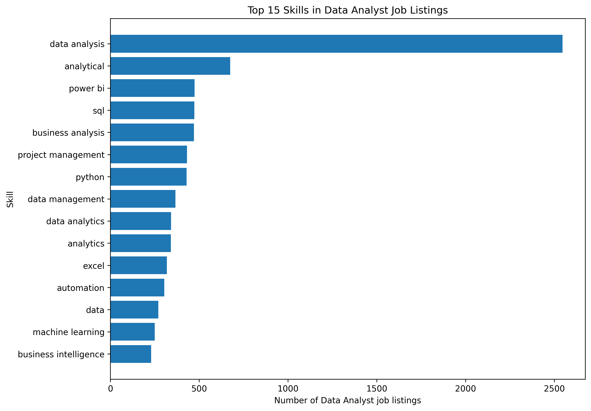
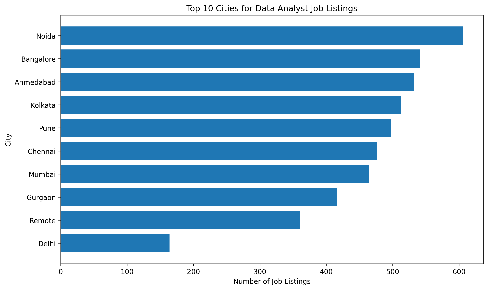
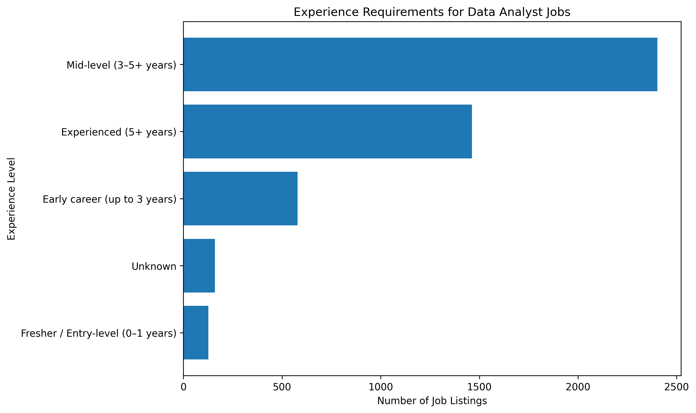
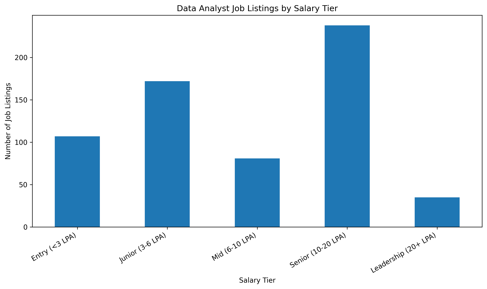

# 📊 Job Market Intelligence 2026

### An End-to-End Data Analytics Portfolio Project

**Objective:** Analyze Data Analyst job postings to identify in-demand technical skills, hiring locations, experience requirements, and salary patterns.

## 🔍 Project Overview

The job market is constantly evolving, and aspiring Data Analysts need to understand which technical skills and qualifications employers request.

This project uses job-posting data to explore hiring requirements and transform raw data into actionable insights. It demonstrates the complete  analytics workflow, from  cleaning to visualization and business recommendations.

## 🎯 Business Questions

- Which technical skills appear most frequently in Data Analyst job postings?
- How often do employers request Excel, SQL, Python, and Power BI?
- Which cities have the highest number of postings in the selected dataset?
- What experience levels do employers request?
- How much salary information is disclosed in job postings?
- What learning priorities can aspiring Data Analysts consider based on the findings?

## 🛠️ Tools and Technologies

| Tool | Purpose |
|---|---|
| Microsoft Excel | Initial data exploration, filtering, and PivotTables |
| Python | Data cleaning, analysis, and visualization |
| Pandas | Data manipulation and aggregation |
| Matplotlib | Charts and visualizations |
| SQL | Structured querying and business analysis |
| Power BI | Interactive dashboard and reporting |
| GitHub | Version control and project documentation |

## 📁 Project Structure

```text
job-market-intelligence-2026/
├── data/
│   └── README.md
├── notebooks/
│   └── README.md
├── outputs/
│   ├── charts/
│   │   ├── top_15_data_analyst_skills.png
│   │   ├── top_10_data_analyst_cities.png
│   │   ├── data_analyst_experience_levels.png
│   │   └── data_analyst_salary_tiers.png
│   └── data_analyst_skill_summary.csv
├── python/
│   └── data_analyst_skills.py
├── sql/
│   └── analysis_queries.sql
├── .gitignore
└── README.md
```

## 🔄 Project Workflow

1. **Data collection:** Obtain job-posting data from a documented source.
2. **Data exploration:** Inspect columns, data types, missing values, and duplicates.
3. **Data cleaning:** Standardize text fields, handle missing values, and validate salary information.
4. **Exploratory data analysis:** Analyze skills, locations, experience requirements, and salaries.
5. **SQL analysis:** Use filtering, aggregation, grouping, and sorting to answer business questions.
6. **Data visualization:** Create charts to communicate important patterns.
7. **Dashboard development:** Build a Power BI report with key metrics and filters.
8. **Business recommendations:** Translate observed patterns into practical learning priorities.

## 📈 Key Performance Indicators

The analysis tracks the following key performance indicators:

- Total job postings analyzed
- Number and percentage of postings mentioning each skill
- Posting counts by location
- Distribution of experience requirements
- Percentage of postings with usable salary information
- Salary statistics for comparable records with disclosed salaries

## 💡 Expected Deliverables

- Documented job-posting dataset source and data-quality considerations
- Python analysis script for Data Analyst job listings
- SQL query collection for business analysis
- Visualizations for skills, locations, experience, and salary patterns
- Summary CSV containing Data Analyst skill counts and percentages
- Power BI dashboard (planned)
- Findings, limitations, and evidence-based recommendations

## 📊 Initial Analysis: Data Analyst Skills

The selected dataset contains 23,201 job listings across six technology job categories, including 4,729 listings categorized as Data Analyst roles.

The initial skills analysis identified the following frequently occurring skill labels in Data Analyst job postings:

| Skill | Job Listings | Share of Data Analyst Listings |
|---|---:|---:|
| Data Analysis | 2,546 | 53.84% |
| Power BI | 474 | 10.02% |
| SQL | 473 | 10.00% |
| Python | 429 | 9.07% |
| Excel | 318 | 6.72% |

These figures represent mentions in the selected dataset, not the entire job market. Skill labels have not yet been consolidated into broader skill categories.

### 📈 Skills Visualization



### 💡 Initial Observations

- Data Analysis is the most frequently occurring skill label in this dataset.
- Power BI and SQL have similar mention counts.
- Python and Excel also appear among the frequently mentioned skills.
- Further analysis is needed to validate the data and investigate locations, experience requirements, and salary patterns.

### 🛠️ Tools Used

- Python
- Pandas
- Matplotlib
- GitHub

### 🔜 Next Steps

- Review and refine the completed city, experience, and salary analyses.
- Validate data quality, including inconsistent experience values and unusual salary records.
- Review the completed work-mode and SQL analyses for accuracy.
- Build a Power BI dashboard to present the key findings interactively.

### 📍 City Analysis: Top 10 Locations

The dataset contains 4,729 Data Analyst job listings. The following table shows the top 10 locations by job listing count in the selected dataset.

| City | Job Listings |
|---|---:|
| Noida | 606 |
| Bangalore | 541 |
| Ahmedabad | 532 |
| Kolkata | 512 |
| Pune | 498 |
| Chennai | 477 |
| Mumbai | 464 |
| Gurgaon | 416 |
| Remote | 360 |
| Delhi | 164 |

### 🔍 Key Findings

- **Noida** recorded the highest number of listings, with 606.
- **Bangalore** ranked second with 541 listings.
- **Ahmedabad** ranked third with 532 listings.
- **Remote** appeared as a separate category, with 360 listings.
- **Delhi** had the lowest count among these top 10 entries, with 164 listings.

### 📊 City Analysis Visualization



*Note: These findings represent the selected dataset and should not be interpreted as a complete measure of current hiring demand across India.*
## 📚 Dataset and Data Quality

The analysis uses the **Indian Tech Job Market 2026** dataset obtained from Kaggle. The dataset contains 23,201 job listings across 32 columns, with job-posting data sourced from Naukri.com.

Although the dataset title refers to 2026, its reported collection date is June 10, 2025. Therefore, the findings represent the selected dataset and should not be interpreted as current, real-time hiring trends.

The analysis considers data quality issues involving missing information, experience values, salary ranges, and potential outliers. Salary statistics are calculated using listings with valid, disclosed salary information.

**License:** The dataset is listed under CC BY-SA 4.0. Refer to the original Kaggle dataset page for licensing and attribution requirements. The raw dataset is not included in this repository.

## ⚠️ Limitations

- Job postings may contain duplicate or reposted vacancies.
- A skill mentioned in a description does not necessarily indicate its importance to the employer.
- Salary information may be missing or inconsistent.
- One platform's postings may not represent the entire job market.
- Historical data cannot automatically represent current hiring trends.

## 🚀 Future Improvements

- Add a Power BI dashboard with interactive filters.
- Compare job-market patterns across supported time periods.
- Improve skill extraction using natural language processing.
- Add automated data-quality checks.
- Refresh the analysis when new, comparable data becomes available.

## 👩‍💻 Author

**Majji Venkata Rajeev Hari Priya**

Aspiring Data Analyst | Excel | Python | SQL | Power BI

**Portfolio objective:** Demonstrate practical data analysis, problem-solving, visualization, and evidence-based decision-making skills.

## 📊 Experience Requirements for Data Analyst Jobs

The analysis examined 4,729 Data Analyst job listings to understand the experience levels requested in the selected dataset.

| Experience Level | Job Listings | Percentage |
|---|---:|---:|
| Mid-level (3–5+ years) | 2,402 | 50.79% |
| Experienced (5+ years) | 1,462 | 30.92% |
| Early career (up to 3 years) | 579 | 12.24% |
| Fresher / Entry-level (0–1 years) | 126 | 2.66% |
| Unknown | 160 | 3.38% |
| **Total** | **4,729** | **99.99%** |

*Percentages may not total exactly 100% due to rounding.*

### Key Findings

- Mid-level roles account for 50.79% of listings.
- Experienced roles account for 30.92% of listings.
- Fresher or entry-level roles account for 2.66% under the classification used.
- Experience information could not be classified for 160 listings (3.38%).

### 📈 Experience-Level Visualization



### Data Quality Note

Experience categories were derived from the original experience-range text. These are preliminary analytical groupings, not official industry standards. Some listings contain inconsistent numeric experience fields, and 160 listings could not be classified. Further validation is required before drawing conclusions about entry-level opportunities.

*These results describe the selected dataset and do not represent the entire Indian job market.*


## 💰 Salary Analysis for Data Analyst Jobs

This analysis examines salary information from 4,729 Data Analyst job listings in the selected dataset.

### Salary Disclosure

- Total Data Analyst job listings: 4,729
- Listings with disclosed salary: 640 (13.53%)
- Listings without disclosed salary: 4,089

Salary information was available for only a small proportion of listings, so the salary statistics below should be interpreted with caution.

### Salary Statistics

The analysis included 633 listings with disclosed and valid salary ranges.

| Metric | Result |
|---|---:|
| Average minimum salary | 8.12 LPA |
| Average maximum salary | 13.29 LPA |
| Median salary midpoint | 9.50 LPA |
| Lowest listed minimum salary | 0.05 LPA |
| Highest listed maximum salary | 90.00 LPA |

### Job Listings by Salary Tier

| Salary Tier | Job Listings |
|---|---:|
| Entry (<3 LPA) | 107 |
| Junior (3–6 LPA) | 172 |
| Mid (6–10 LPA) | 81 |
| Senior (10–20 LPA) | 238 |
| Leadership (20+ LPA) | 35 |

### Key Findings

- Salary information was disclosed in 13.53% of Data Analyst listings.
- Senior roles (10–20 LPA) formed the largest salary tier among the 633 valid salary records.
- The median salary midpoint was 9.50 LPA.
- The maximum listed salary of 90 LPA and minimum of 0.05 LPA should be validated as potential outliers or unusual records.

### Salary Visualization



### Limitations

These results represent only the selected dataset and the listings with usable salary information. They should not be treated as definitive salary benchmarks for the entire Indian job market.


## 🗃️ SQL Analysis

SQL queries were executed using DuckDB in Google Colab to analyze Data Analyst job postings.

The analysis covers:

- Total job listings and Data Analyst job counts
- Top 10 locations by job listing count
- Salary disclosure rates and salary statistics
- Job listings by work mode (on-site, remote, and hybrid)
- Job listings by experience level
- Top 10 Data Analyst job titles

**SQL queries:** [`sql/analysis_queries.sql`](sql/analysis_queries.sql)
